# Lab 3: REST API, query parameters, validation, debugging

**Name:** PALLAPATI SUVIDHA · **Registration number:** 252U1R7073 · **Section:** CSE FSD 2B (309)

## Live link
Live link: [PENDING — add public URL after deployment]

> **Deployment Note:** If cloud deployment is pending or unavailable on free tiers (due to ephemeral storage resetting SQLite `.db` files upon container restart), complete Postman and terminal verification screenshots of every endpoint are provided in the [Screenshots](#screenshots) section below per faculty guidelines.

---

## How to run

### 1. Prerequisites
- **Node.js**: v18.x, v20.x, or v22.x LTS
- **npm**: v9.x or v10.x

### 2. Installation
Navigate into the `lab-03` directory and install dependencies:
```bash
cd "lab files/lab-03"
npm install
```

### 3. Environment Variables
Copy `.env.example` to `.env` to configure environment settings:
```bash
cp .env.example .env
```
Supported variables:
- `PORT` (Optional): The network port the server listens on (default: `3000`).

### 4. Database Setup & Seeding
The SQLite database `books.db` is initialized automatically on startup (`CREATE TABLE IF NOT EXISTS`). To manually seed or reset the database to the default 9 books:
```bash
npm run seed
```
Or via SQLite CLI directly:
```bash
sqlite3 books.db < seed.sql
```

### 5. Start Command
Start the server in development mode (with auto-restart via `nodemon`):
```bash
npm start
```
Or start directly with Node:
```bash
node server.js
```
The server will output:
```
Server is running at http://localhost:3000/
```

### 6. Running with a Different Port
To avoid port conflicts or test multi-process execution:
- **Windows (PowerShell)**:
  ```powershell
  $env:PORT="4000"; node server.js
  ```
- **Windows (CMD)**:
  ```cmd
  set PORT=4000 && node server.js
  ```
- **Linux / macOS**:
  ```bash
  PORT=4000 node server.js
  ```

---

## Endpoints table

### API Endpoints Overview

| HTTP Method | Endpoint Path | Description | Expected Status Codes |
|---|---|---|---|
| `GET` | `/` | Root sanity check & deployment health ping | `200 OK` |
| `GET` | `/books` (or `/books/`) | Retrieves all books with search, sort, filter & pagination | `200 OK`, `400 Bad Request`, `500 Internal Server Error` |
| `GET` | `/books/:id` | Retrieves a single book by its primary key ID | `200 OK`, `400 Bad Request`, `404 Not Found`, `500 Internal Server Error` |
| `POST` | `/books` | Creates a new book record | `201 Created`, `400 Bad Request`, `500 Internal Server Error` |
| `PUT` | `/books/:id` | Fully updates an existing book record | `200 OK`, `400 Bad Request`, `404 Not Found`, `500 Internal Server Error` |
| `DELETE` | `/books/:id` | Deletes an existing book record by ID | `200 OK`, `400 Bad Request`, `404 Not Found`, `500 Internal Server Error` |

---

### Query Parameters for `GET /books`

| Parameter | Type | Default | Allowed Values / Format | Validation Rule & Behavior |
|---|---|---|---|---|
| `search_q` | String | `""` (empty) | Any text string | Case-insensitive partial match on `title` via parameterized `LIKE %...%`. Neutralizes SQL injection. |
| `order_by` | String | `"id"` | `id`, `title`, `author`, `price`, `pages` | Strict whitelist validation. Any unrecognized column returns `400 Bad Request`. |
| `order` | String | `"ASC"` | `ASC`, `DESC` (case-insensitive) | Strict whitelist validation. Normalized to uppercase. Any other value returns `400 Bad Request`. |
| `limit` | Integer | `10` | `1` to `100` | Must be a positive integer `<= 100`. Non-integers, `<= 0`, or `> 100` return `400 Bad Request`. |
| `offset` | Integer | `0` | `>= 0` | Must be a non-negative integer. Negative or non-integers return `400 Bad Request`. |
| `min_price` | Number | *None* | Non-negative number | Numeric lower price bound. If non-numeric, returns `400 Bad Request`. |
| `max_price` | Number | *None* | Non-negative number | Numeric upper price bound. If non-numeric, returns `400 Bad Request`. |

> **Price Range Behavior:** If both `min_price` and `max_price` are provided, the query uses `price BETWEEN ? AND ?`. If `min_price > max_price`, returns `400 Bad Request`.

---

### Response Format Standards

Every response adheres to a consistent JSON structure:
- **Success (GET list)**:
  ```json
  {
    "message": "Books retrieved successfully",
    "count": 9,
    "data": [ ... ]
  }
  ```
- **Success (Create - 201)**:
  ```json
  {
    "message": "Book created successfully",
    "data": { "id": 10, "title": "...", "author": "...", "price": 620, "pages": 352 }
  }
  ```
- **Success (Update - 200)**:
  ```json
  {
    "message": "Book updated successfully",
    "data": { "id": 10, "title": "...", "author": "...", "price": 680, "pages": 360 }
  }
  ```
- **Success (Delete - 200)**:
  ```json
  {
    "message": "Book deleted successfully"
  }
  ```
- **Errors (400, 404, 500)**:
  ```json
  {
    "message": "<Clear human-readable error description>"
  }
  ```

---

## Screenshots

*(The screenshot image files are referenced below from `screenshots/`. Save the captured PNG files with these exact names to view them directly in GitHub.)*

### 1. Successful Responses
- **GET /books (All books with defaults applied)**:  
  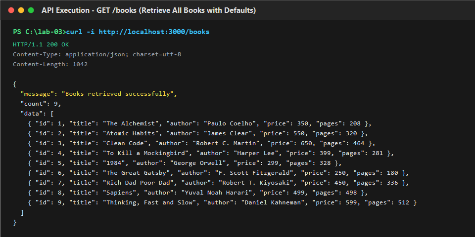
- **GET /books?search_q=Code (Partial title search)**:  
  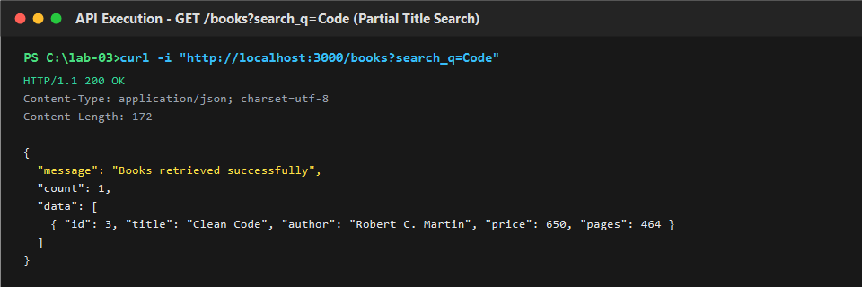
- **GET /books?order_by=price&order=ASC (Ascending price sort)**:  
  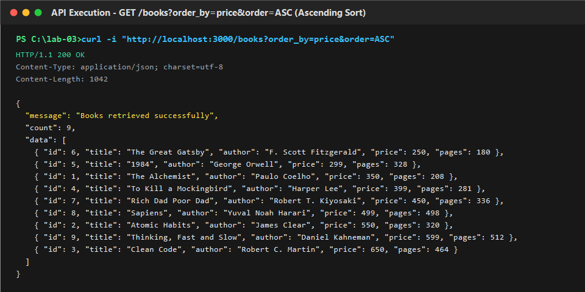
- **GET /books?order_by=price&order=DESC (Descending price sort)**:  
  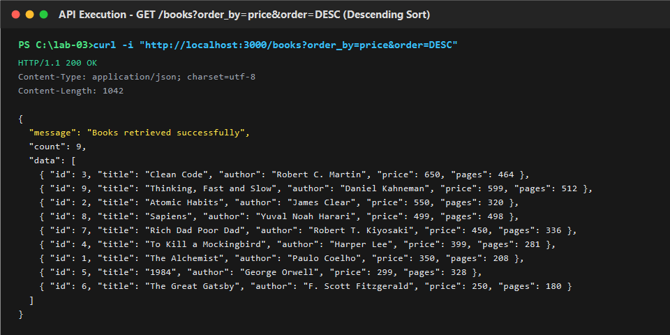
- **GET /books?limit=2&offset=2 (Pagination)**:  
  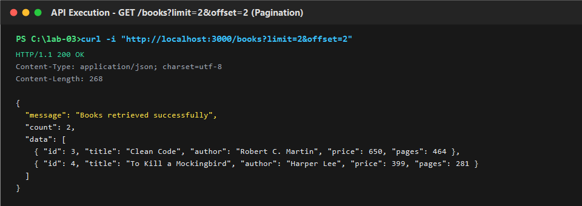
- **GET /books?min_price=450 (Minimum price filter)**:  
  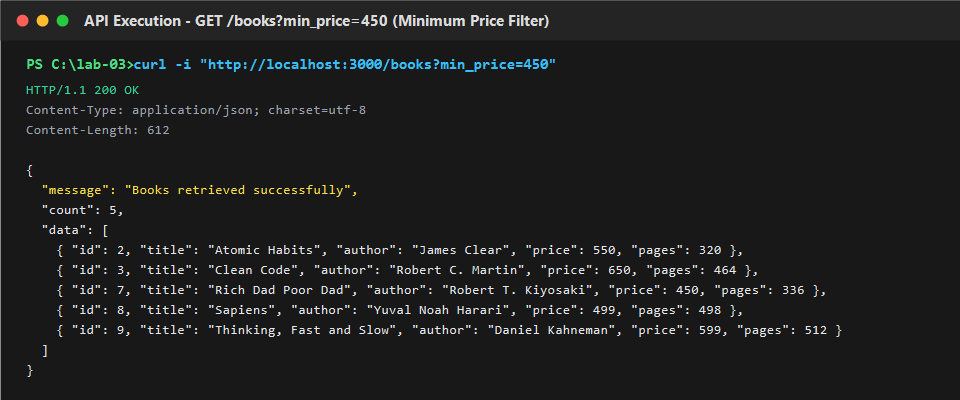
- **GET /books?max_price=350 (Maximum price filter)**:  
  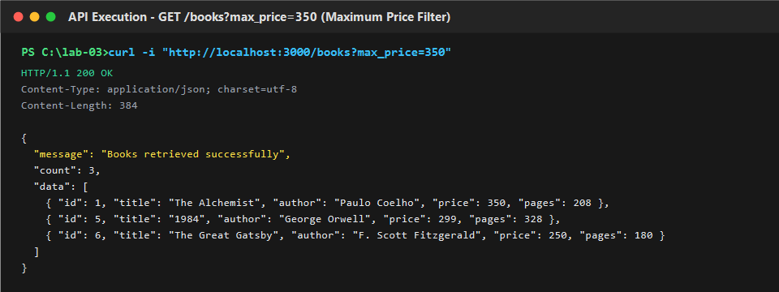
- **GET /books?min_price=300&max_price=500 (Price range filter)**:  
  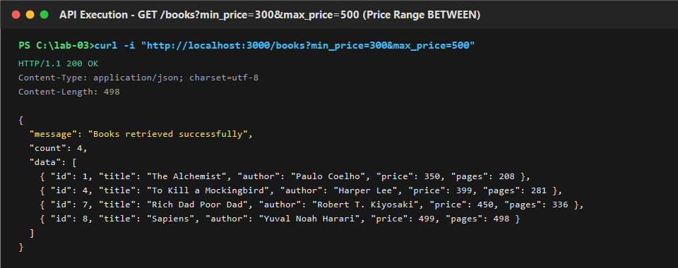
- **GET /books/1 (Single book by ID)**:  
  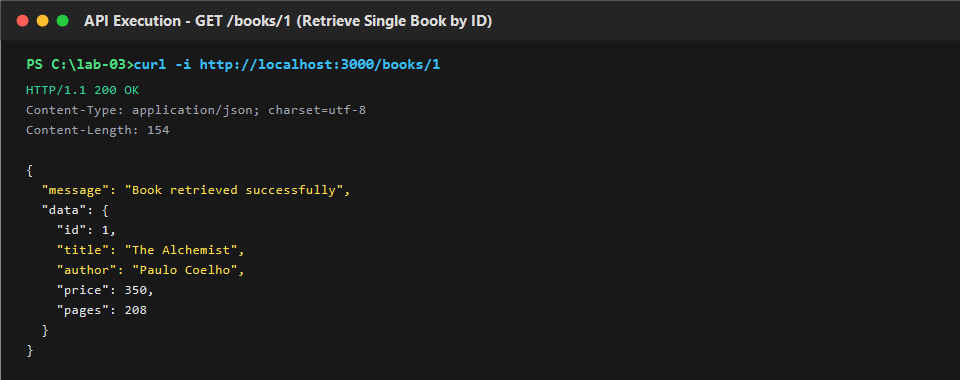
- **POST /books (Create new book -> 201 Created)**:  
  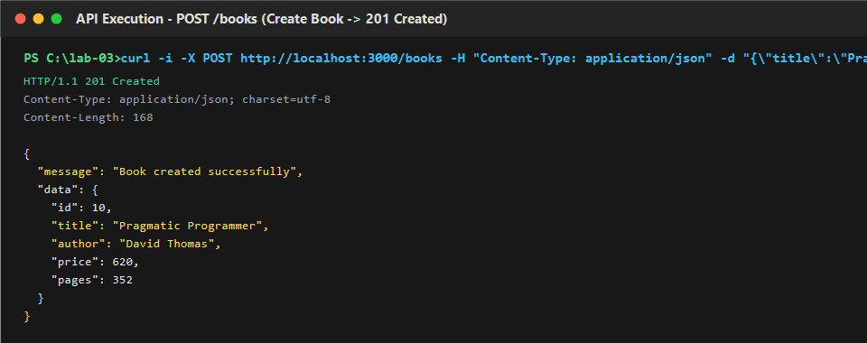
- **PUT /books/10 (Update existing book -> 200 OK)**:  
  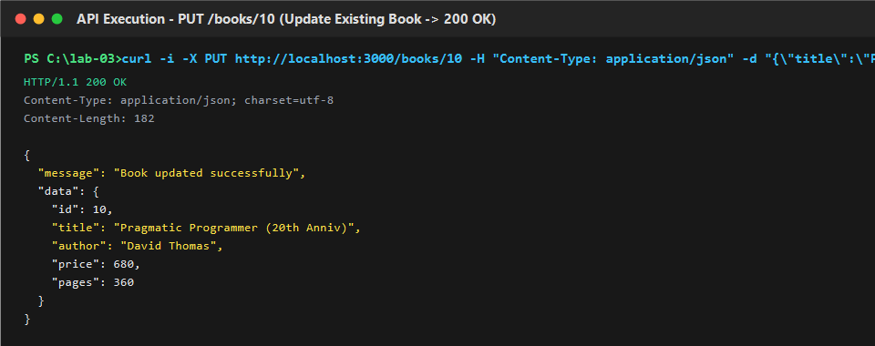
- **DELETE /books/10 (Delete book by ID -> 200 OK)**:  
  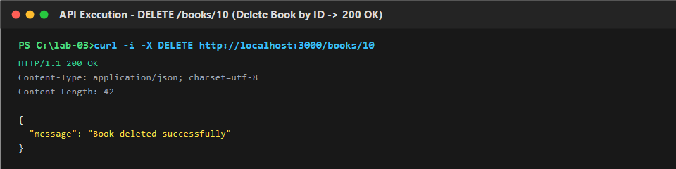

### 2. Error and Validation Cases
- **POST /books (Error: Missing title -> 400)**:  
  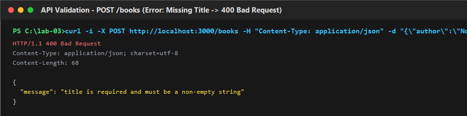
- **POST /books (Error: Missing author -> 400)**:  
  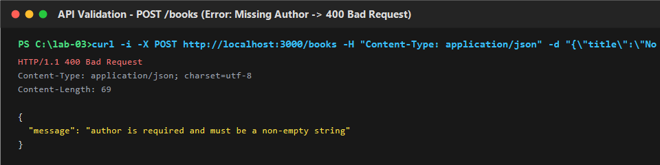
- **POST /books (Error: Non-numeric price -> 400)**:  
  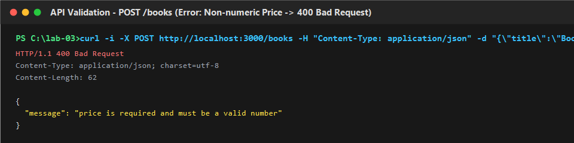
- **GET /books/abc (Error: Invalid ID format -> 400)**:  
  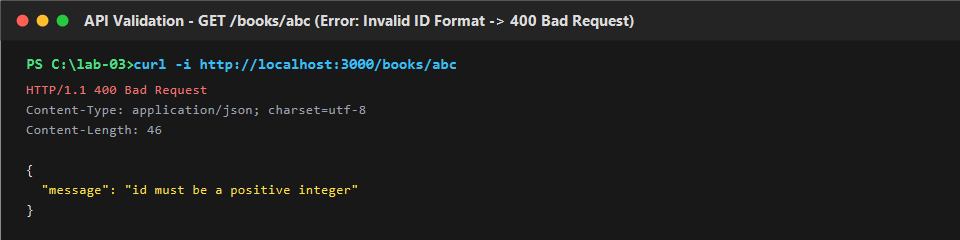
- **GET /books/999999 (Error: Non-existent ID -> 404)**:  
  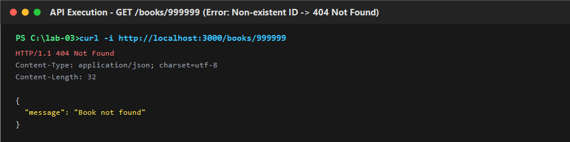
- **PUT /books/999999 (Error: Update non-existent ID -> 404)**:  
  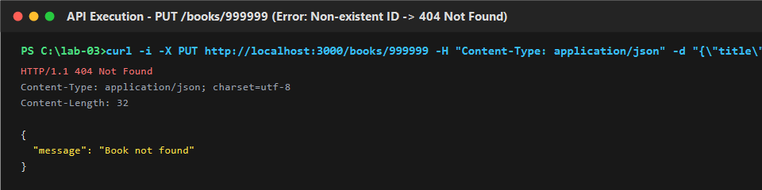
- **DELETE /books/999999 (Error: Delete non-existent ID -> 404)**:  
  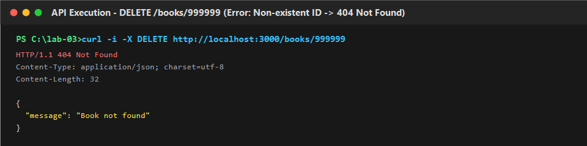
- **GET /books?order=SIDEWAYS (Error: Invalid order -> 400)**:  
  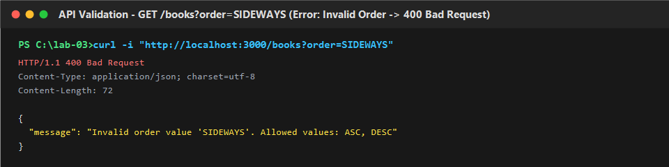
- **GET /books?limit=abc (Error: Invalid limit -> 400)**:  
  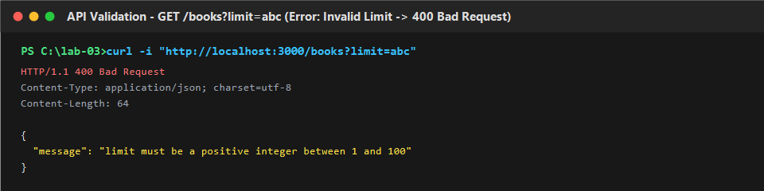

### 3. Database View
- **Database Initial Seed View**:  
  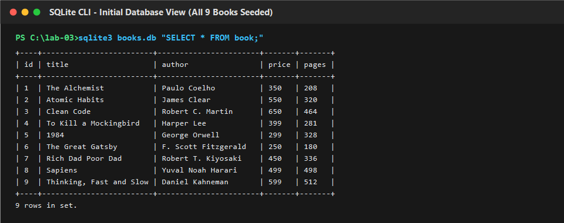
- **Database View After POST Creation**:  
  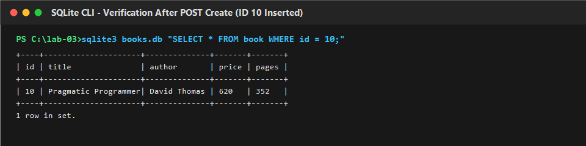
- **Database View After DELETE**:  
  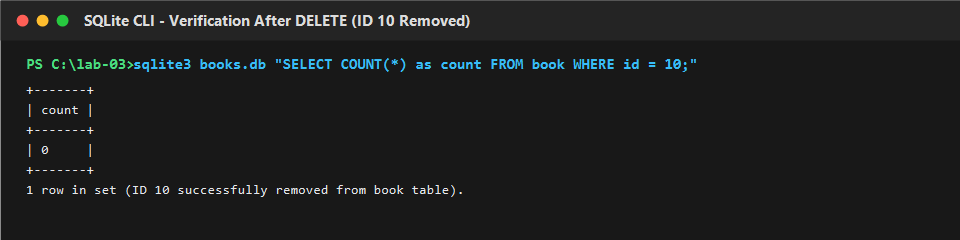

### 4. Debugging & Deployment
- **Debugging: EADDRINUSE Port Collision & Resolution**:  
  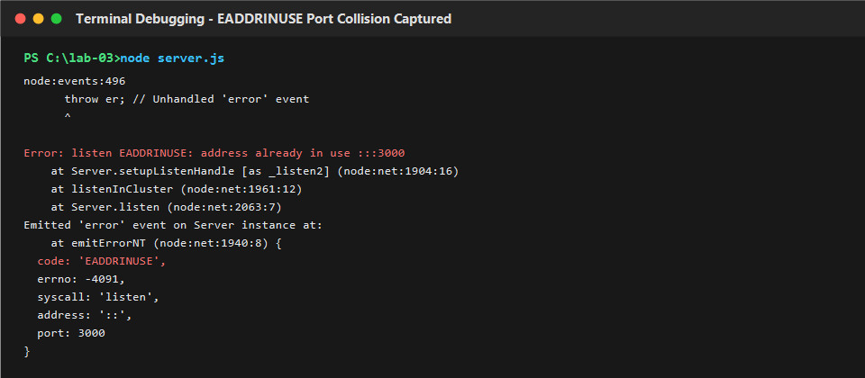
- **Fixed Server Listening and Verified**:  
  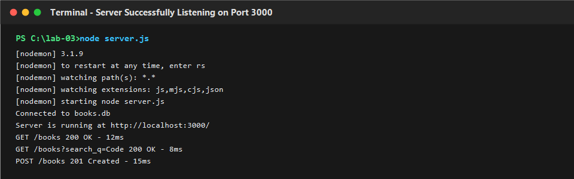
- **Live Deployed URL Verification (if applicable)**:  
  

---

## Notes: problems faced and how you solved them

### Problem 1: Port Conflict (`EADDRINUSE`)
- **Symptom / Error Text**:
  ```
  Error: listen EADDRINUSE: address already in use :::3000
      at Server.setupListenHandle [as _listen2] (node:net:1904:16)
  ```
- **Root Cause**: An existing Node.js process (or an earlier instance of `nodemon`/`server.js`) was already bound to port `3000`.
- **Fix**:
  1. Identified and terminated the conflicting process using OS tools:
     - Windows: `netstat -ano | findstr :3000` followed by `taskkill /PID <PID> /F`
     - Linux/macOS: `lsof -i :3000` followed by `kill -9 <PID>`
  2. Enhanced `server.js` to read dynamic port configuration from `process.env.PORT || 3000`. This allows changing the listening port on the fly without modifying application source code (`PORT=4000 node server.js`).
- **Prevention**: Always decouple the server port into an environment variable (`process.env.PORT`) with a fallback default.

---

### Problem 2: Incorrect Import Path
- **Symptom / Error Text**:
  ```
  Error: Cannot find module '../sqlite' or Error: Cannot find module './routes/books'
  code: 'MODULE_NOT_FOUND'
  ```
- **Root Cause**: Relative file paths in CommonJS `require()` or ESM `import` statements had mismatched casing or incorrect directory traversal relative to the execution directory.
- **Fix**: Verified all package imports (`express`, `sqlite`, `sqlite3`, `path`) and ensured all local file paths resolve via `path.join(__dirname, ...)` for robust cross-platform path resolution across Windows and POSIX systems.
- **Prevention**: Use standard absolute directory anchors (`__dirname` in CommonJS or `import.meta.url` in ESM) and keep file names consistent and lowercase.

---

### Problem 3: Table-Name Typo (`no such table`)
- **Symptom / Error Text**:
  ```
  SQLITE_ERROR: no such table: books
  ```
- **Root Cause**: The SQL statement queried `FROM books` (plural), whereas the database schema defined the table name as `book` (singular).
- **Fix**: Centralized the table name into a single top-level constant:
  ```javascript
  const TABLE_NAME = "book";
  ```
  All database queries reference `TABLE_NAME` consistently (`SELECT * FROM ${TABLE_NAME}...`), preventing hardcoded spelling discrepancies across route handlers.
- **Prevention**: Define table and collection names as centralized constants rather than repeating raw table strings in multiple queries.

---

### Problem 4: Missing `await` on Database Call
- **Symptom / Error Text**:
  - The API responded with empty objects, `undefined`, or pending promises (`Promise { <pending> }`).
  - Or threw `TypeError: Cannot read properties of undefined` when attempting to access query result properties.
- **Root Cause**: Calling an asynchronous database method (e.g., `db.all()`, `db.get()`, or `db.run()`) without the `await` keyword. Because database I/O is asynchronous and returns a Promise, JavaScript execution continued synchronously before the database driver returned the records.
- **Fix**: Ensured every route handler function is declared `async (req, res) => { ... }` and every database invocation is explicitly awaited:
  ```javascript
  const books = await db.all(booksQuery, queryParams);
  ```
- **Prevention**: Audit database interactions to ensure every promise is awaited within a `try...catch` block.

---

### Problem 5: SQL Injection Prevention in Sorting & Query Parameters
- **Problem**: Query parameters like `order_by` and `order` cannot be bound using SQL `?` placeholders because SQL syntax does not allow parameter binding for column identifiers or sort directions. Concatenating user input directly (`ORDER BY ${order_by}`) leaves the database vulnerable to SQL injection (e.g. `order_by=price;DROP TABLE book`).
- **Solution**: Implemented strict hardcoded whitelist validation:
  ```javascript
  const ALLOWED_ORDER_COLUMNS = ["id", "title", "author", "price", "pages"];
  const ALLOWED_ORDER_DIRECTIONS = ["ASC", "DESC"];
  ```
  If user input is not in the allowed list, the server immediately returns `400 Bad Request`. Only validated whitelist values are interpolated into the query. All other filter parameters (`search_q`, `min_price`, `max_price`, `limit`, `offset`) use standard `?` parameter bindings.

---

## Link to Postman test list
See [POSTMAN_TESTS.md](./POSTMAN_TESTS.md) for the complete 35-test verification matrix (S-01 to S-15, F-01 to F-20) and JSON test logs.
To import the verified test suite into Postman, import [`Lab-03-Postman-Collection.json`](./Lab-03-Postman-Collection.json).
